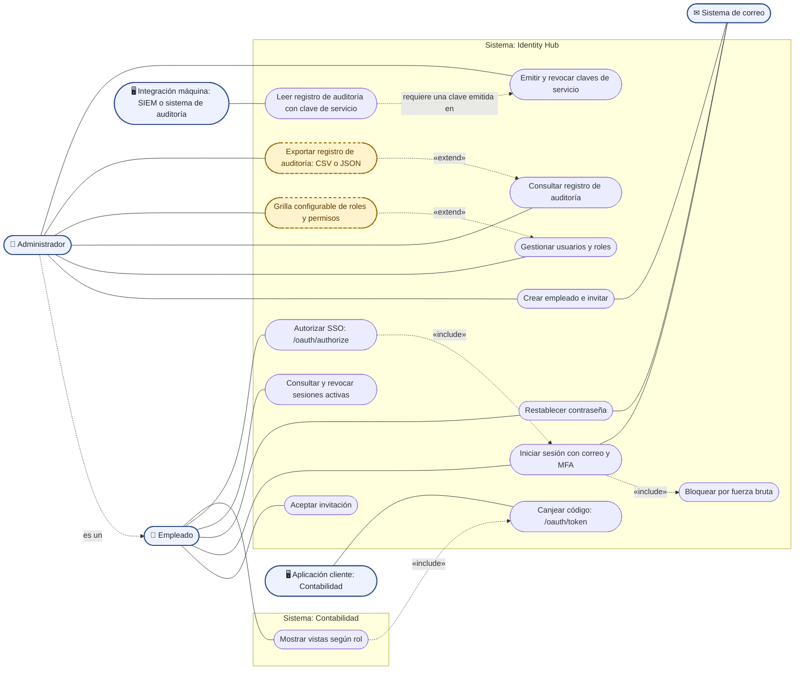

# Casos de uso de Identity Hub

Mermaid no incorpora un tipo nativo para casos de uso; por eso este diagrama usa un flujo con la notación habitual: actores fuera de los límites de cada sistema, casos de uso como óvalos dentro, relaciones «include» y «extend» punteadas, y los casos de uso que amplían a otro, con borde discontinuo. El administrador es también un empleado: hereda sus casos de uso.

Fuente: `specs/03-api/openapi.yaml`, `backend/cmd/api/main.go`, `backend/internal/api/server.go`, `backend/internal/auth/login/login.go`, `backend/internal/auth/mfa/mfa.go`, `backend/internal/auth/session/session.go`, `backend/internal/auth/oauth/oauth.go`, `backend/internal/auth/auditlog/`, `backend/internal/auth/servicekey/`, `specs/adr/0014-claves-de-servicio-para-integraciones-maquina.md` y `contabilidad/src/auth/flow.ts`.
