# Despliegue local con Docker Compose

La topología representa el archivo Compose actual: todos los servicios usan la red predeterminada `identity-hub_default` con subred `172.28.0.0/16`; los componentes de observabilidad se habilitan mediante el perfil `observability`.

```mermaid
flowchart TB
    Host["Host de desarrollo"]
    Network["Red identity-hub_default\n172.28.0.0/16"]
    Web["web\nNginx\nHost: 8080"]
    API["api\nHost: 8081"]
    Worker["worker\nHost: 9091 (/metrics)"]
    Migrate["migrate\nEjecución única"]
    DB[("db: PostgreSQL\nHost: 5432\nVolumen: pgdata")]
    Broker[("broker: RabbitMQ\nHost: 5672 (AMQP), 15672 (administración)\nVolumen: rabbitdata")]
    Mailpit["mailpit\nHost: 1025 (SMTP con STARTTLS y AUTH), 8025 (web/API)"]
    Prometheus["prometheus (perfil observability)\nHost: 9090"]
    Loki["loki (perfil observability)\nHost: 3100"]
    Alloy["alloy (perfil observability)\nSin puerto publicado"]
    Grafana["grafana (perfil observability)\nHost: 3000\nVolumen: grafanadata"]
    Falco["falco (perfil observability)\nSin puerto publicado\nmodern eBPF"]
    Certs["Bind mount: deploy/certs (make certs, solo lectura)\nserver.pem, server-key.pem, smtp-auth.txt"]
    CACert["Bind mount: certs/ca.pem (solo lectura)"]
    FalcoRules["Bind mounts: falco/rules.d, /proc y docker.sock (solo lectura)"]
    PgInit["Bind mount: postgres-init/01-identity-app-role.sh (solo lectura)"]
    Migrations["Bind mount: db/migrations (solo lectura)"]
    PrometheusConfig["Bind mount: observability/prometheus.yml (solo lectura)"]
    AlloyConfig["Bind mounts: alloy.river y docker.sock (solo lectura)"]
    GrafanaConfig["Bind mount: observability/grafana (solo lectura)"]
    RuntimeTmpfs["tmpfs: /tmp (api, worker y web)"]

    Host -->|"identityhub.localhost:8080"| Web
    Host -->|"contabilidad.localhost:8080"| Web
    Host -->|"8081"| API
    Host -->|"5432"| DB
    Host -->|"5672, 15672"| Broker
    Host -->|"1025, 8025"| Mailpit
    Host -->|"9091"| Worker
    Host -->|"9090"| Prometheus
    Host -->|"3100"| Loki
    Host -->|"3000"| Grafana

    subgraph Compose["Docker Compose: identity-hub"]
        Network
        Web
        API
        Worker
        Migrate
        DB
        Broker
        Mailpit
        Prometheus
        Loki
        Alloy
        Grafana
        Falco
    end

    Web --- Network
    API --- Network
    Worker --- Network
    Migrate --- Network
    DB --- Network
    Broker --- Network
    Mailpit --- Network
    Prometheus --- Network
    Loki --- Network
    Alloy --- Network
    Grafana --- Network
    Falco --- Network
    API --> DB
    API --> Broker
    Worker --> Broker
    Worker -->|"SMTP STARTTLS + AUTH"| Mailpit
    Certs --> Mailpit
    CACert --> Worker
    Falco -->|"alertas JSON por stdout"| Alloy
    FalcoRules --> Falco
    Migrate --> DB
    Prometheus --> API
    Prometheus --> Worker
    Alloy --> Loki
    Grafana --> Prometheus
    Grafana --> Loki
    PgInit --> DB
    Migrations --> Migrate
    PrometheusConfig --> Prometheus
    AlloyConfig --> Alloy
    GrafanaConfig --> Grafana
    RuntimeTmpfs --> API
    RuntimeTmpfs --> Worker
    RuntimeTmpfs --> Web
```

Mailpit exige STARTTLS y autenticación con los archivos que genera `make certs` (idempotente; `make up` y `make up-obs` lo ejecutan primero) y el worker confía en la CA local mediante `SMTP_CA_FILE`. Falco observa las llamadas al sistema de todos los contenedores del host, pero solo evalúa sus reglas sobre `api`, `worker` y `web`. La referencia de despliegue en nube para producción está en el [despliegue AWS](despliegue-aws.md); este diagrama solo representa el entorno local.

Fuente: `deploy/docker-compose.yml`, `frontend/Dockerfile`, `frontend/nginx/default.conf`, `scripts/gen-smtp-certs.sh` y `docs/runbooks/falco-alerta.md`.
